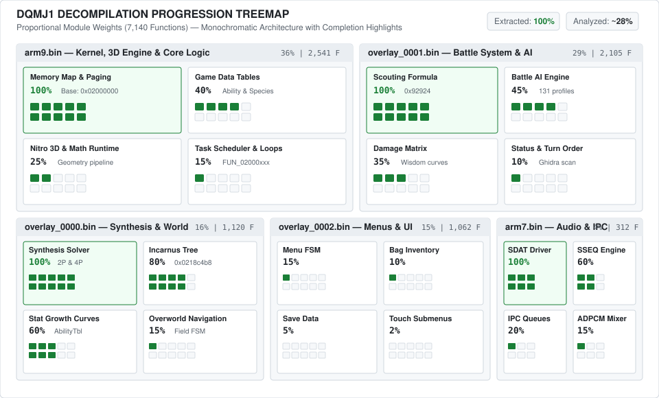

# Source Code Reconstruction & Decompilation Completion Map

This document tracks the progressive reconstruction of the C source code for **Dragon Quest Monsters: Joker** (Nintendo DS, `NTR-AJRP-EUR`).

Following decompilation project standards (similar to `pret` and `zeldaret`), this map distinguishes between **raw Ghidra pseudo-C export**, **functional reverse analysis & symbol recovery**, and **authentic byte-matching decompilation**.

---

## 1. Executive Status Overview

- **ROM Binary Tables & Asset Extractors**: **100%** (210 monsters, synthesis, battle formulas, 3D assets, audio).
- **Ghidra Pseudo-C Baseline**: **100%** (7,140 functions dumped across ARM9, ARM7, and Overlays 0/1/2).
- **Functions Analyzed & Semantically Named**: **~28%** (Key game loops, synthesis solver, capture formula, table loaders).
- **Matching Recompilation (Target byte-to-byte C)**: **In Progress / Initial Setup** (Build system configuration).

---

## 2. Decompilation Treemap (Market Capitalization Style Mosaic)

The diagram below represents executable modules sized proportionally to their function volume and code size, showing sub-component progress via multi-tile 2D block matrices:

---

## 3. Core Executable Modules & Overlays

| Module | Target Processor | Base Address | Total Funcs | Ghidra Pseudo-C | Analyzed / Named | Matching C | Status |
| :--- | :--- | :---: | :---: | :---: | :---: | :---: | :---: |
| **`arm9.bin`** | ARM946E-S (v5TE) | `0x02000000` | 2,541 | [DONE] 100% | [WIP] ~18% (457) | [TODO] 0% | In Progress |
| **`arm7.bin`** | ARM7TDMI (v4T) | `0x02380000` | 312 | [DONE] 100% | [WIP] ~35% (109) | [TODO] 0% | In Progress |
| **`overlay_0000.bin`** | ARM9 Dynamic Overlay 0 | `0x02184b40` | 1,120 | [DONE] 100% | [WIP] ~48% (538) | [TODO] 0% | In Progress |
| **`overlay_0001.bin`** | ARM9 Dynamic Overlay 1 | `0x02184b40` | 2,105 | [DONE] 100% | [WIP] ~22% (463) | [TODO] 0% | In Progress |
| **`overlay_0002.bin`** | ARM9 Dynamic Overlay 2 | `0x02184b40` | 1,062 | [DONE] 100% | [TODO] ~6% (64) | [TODO] 0% | Queued |
| **Total** | | | **7,140** | **[DONE] 100%** | **[WIP] ~28% (1,631)** | **[TODO] 0%** | **Active Research** |

### Status Legend
- `[DONE]` **100% / Verified**: Module baseline fully extracted and systematically mapped.
- `[WIP]` **In Progress**: Critical sub-routines reverse-engineered, structure offsets mapped, disassembly documented.
- `[TODO]` **Queued / Not Started**: Raw decompilation baseline available (`FUN_xxxxxxxx`), awaiting symbol and type recovery.

---

## 4. Sub-System Functional Breakdown

### A. Game Engine & Core Logic (`arm9.bin` & `overlay_0000.bin`)
- `[DONE]` **Memory Map & Overlay Paging**: Verified execution flow and base addresses (`0x02000000` / `0x02184b40`).
- `[DONE]` **Synthesis Formula Engine**: `FUN_0218bee8` canonical logic completely reverse-engineered (two-parent breeding, family mixing matrix, 16 quadrilinear recipes).
- `[WIP]` **Incarnus Transmutation Tree**: `FUN_0218c4b8` identified and analyzed (partner family switches).
- `[WIP]` **Monster Level-Up & Stat Growth**: Growth curves identified in `AbilityTbl.bin` and linked to `EnmyKindTbl.bin` offsets 22..27.
- `[TODO]` **Main Game Loop & Task Scheduler**: Ongoing disassembly of `FUN_02000xxx` kernel loops.

### B. Battle System & Artificial Intelligence (`overlay_0001.bin`)
- `[DONE]` **Monster Scouting / Taming Formula**: `overlay_0001:0x92924` decompiled (tension multipliers, Oomph impact, base rates, boss flags).
- `[WIP]` **Battle AI Tactical Engine**: 131 decision patterns mapped (`AI_PatternTbl.bin`, `AI_ActionTBL.bin`), tactical role scoring in progress.
- `[WIP]` **Damage Calculation Matrix**: `DamageTbl.bin` parsed, Wisdom threshold scaling under active disassembly.
- `[TODO]` **Status Effect & Turn Order Priority**: Initial Ghidra analysis underway.

### C. Audio & Sound Subsystem (`arm7.bin`)
- `[DONE]` **SDAT Archive & Stream Handling**: Nitro SDAT driver dissected (`sound_data.sdat`).
- `[DONE]` **Sequence Playback Engine**: SSEQ sequence commands, loops, and tempo timers mapped to SWAR multi-sample banks.
- `[WIP]` **Hardware ADPCM / PCM16 Mixing**: ARM7 inter-processor communications (IPC FIFO queues) partially documented.

---

## 5. File Formats & Extraction Tooling Status

| Format | Source Extension | Parser Tool | Documentation | Web / Export Ready | Status |
| :--- | :---: | :---: | :---: | :---: | :---: |
| **3D Meshes & Materials** | `.nsbmd` / `.nsbtx` | `tools/re-models` (Apicula-based) | [DONE] Complete | [DONE] glTF 2.0 / GLB | Production |
| **Skeletal Animations** | `.nsbca` | `tools/re-models` (Apicula-based) | [DONE] Complete | [DONE] glTF Clips | Production |
| **World 3D Maps** | `.map` (FPK) | `tools/map_converter.py` | [DONE] Complete | [DONE] GLB Worlds + Bounds | Production |
| **Audio Sequences & Samples** | `.sdat` (`SSEQ`/`SWAR`) | `tools/sdatextract.py` / `swartowav.py` | [DONE] Complete | [DONE] WAV / MP3 320 kbps | Production |
| **Event Scripts & Cinematics** | `.evt` / `demoNNN.bin` | `tools/evt_vm.py` | [WIP] 220/256 opcodes | [DONE] JSON / Web Player | Refinement |
| **2D UI & Artworks** | `.d16` / `.CHR` / `.SCR` | `tools/d16topng.py` | [DONE] Complete | [DONE] PNG 24-bit | Production |
| **Monster Species Tables** | `EnmyKindTbl.bin` | `tools/extract_monster_stats.py` | [DONE] Complete | [DONE] JSON | Production |
| **Wild Encounter Tables** | `*.enct` (66 zones) | `tools/extract_encounters.py` | [DONE] Complete | [DONE] JSON | Production |

---

## 6. Acknowledgments & Attributions

- **[Apicula Project](https://github.com/scurest/apicula)**: 3D model parsing algorithms build upon Apicula research.
- **[Bubelia](https://dqmj.fandom.com/wiki/Dragon_Quest_Monsters:_Joker_Wiki)**: Founder and author of the popular Dragon Quest Monsters: Joker Wiki on Fandom; technical cross-referencing between ROM data and community wikis, decompilation architecture review, and implementation advice.
- **Bonnford**: In-depth review of game data, story lore accuracy, and Incarnus synthesis mechanics.
- **[Dragon Quest Wiki](https://dragon-quest.org/)**: Community documentation for series preservation.
- **[Ghidra](https://ghidra-sre.org/)**: Reverse engineering framework for disassembly and decompilation baselines.
